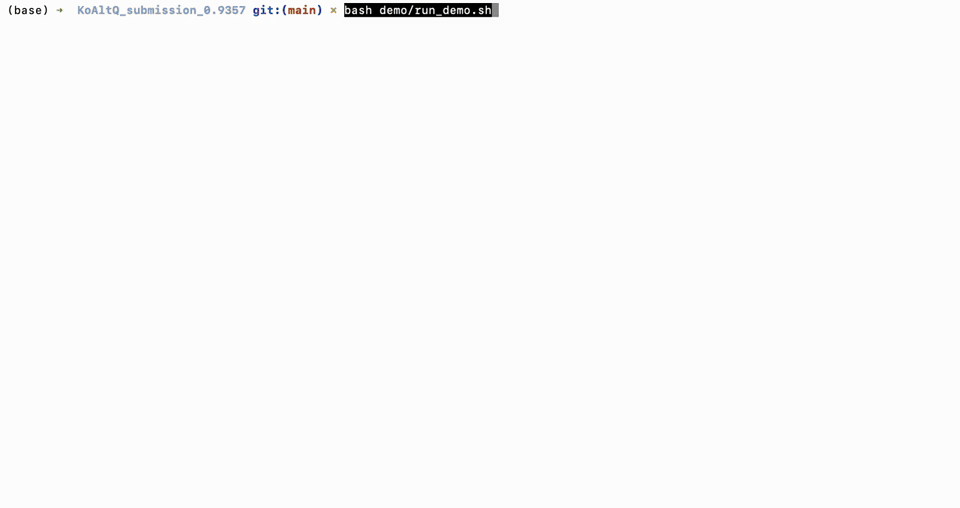
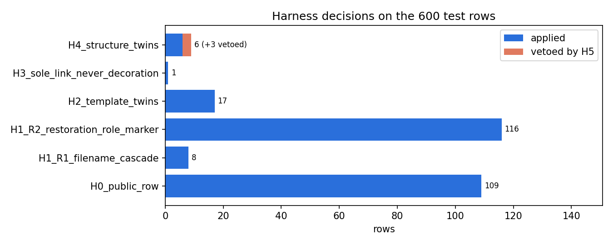
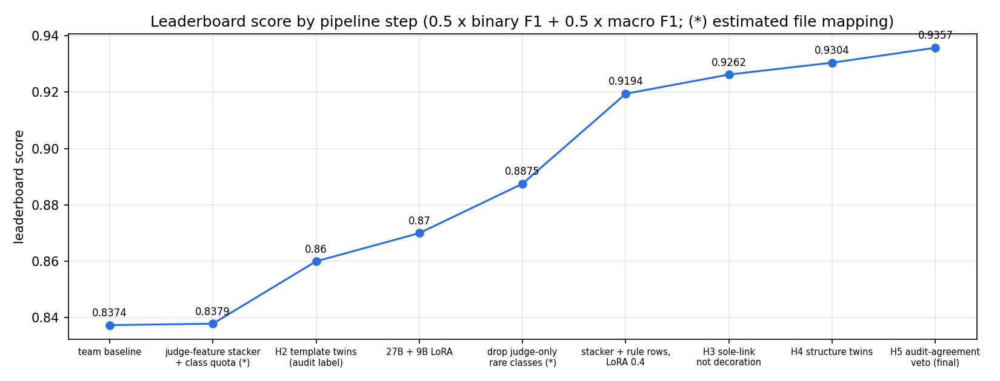
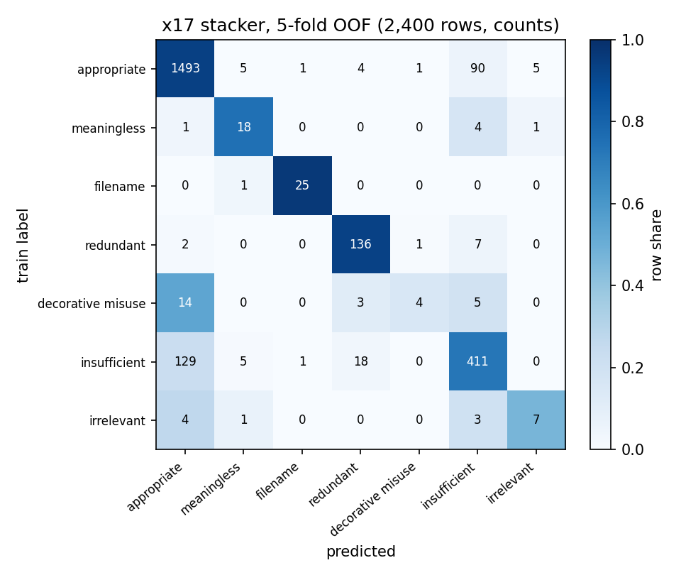
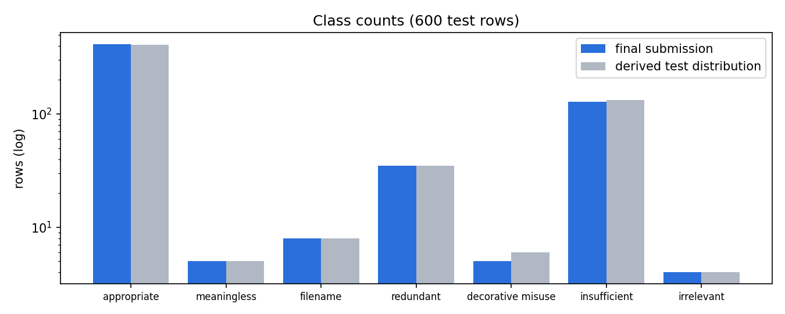

# KoAltQ: 이미지·문맥 정보를 활용한 한국어 웹 대체텍스트 품질 판정

**2026 DATA·AI 분석 경진대회 문제 4 · 팀 못나지않은사람들 · 리더보드 0.9357**

웹 페이지 이미지의 alt 텍스트가 적절한지, 적절하지 않다면 어떤 유형인지를 7개 범주로 판정했습니다.
라벨링 가이드라인을 읽힌 VLM 판정기와 지도학습 모델을 스태커로 묶었고, 마지막에 근거가 분명한 행만 규칙(하네스)으로 보정했습니다.

[](demo/demo_screen_recording.mp4)

위 미리보기는 데모영상을 줄인 것입니다(결정 단계 대기 구간 40배속, 결과 뷰어 구간 4배속).
편집하지 않은 전체 영상(3분 57초)은 [demo/demo_screen_recording.mp4](demo/demo_screen_recording.mp4)에 있습니다.

| 항목 | 내용 |
|---|---|
| 점수 | 리더보드 **0.9357** (0.5 × 이진 F1 0.9579 + 0.5 × 7범주 macro-F1 0.9134) |
| 제출 파일 | `submission/final_submission_0.9357.csv` (600행, sha256 `87c3de688bd2…a9a1cf8`) |
| 재현 | 저장된 모델 출력으로 CPU에서 3\~8분, 제출 파일과 바이트 단위로 같은 파일이 나옴 |
| 모델 | 학습된 모델들의 출력(확률) 포함. 이 출력만으로 최종 결과가 재현됨 ([2절](#2-폴더-구성)) |
| 외부 API | 사용하지 않음. 모든 모델은 공개 가중치를 내려받아 직접 실행 |

---

## 1. 바로 실행해 보기

학습이나 GPU 없이, 저장된 모델 출력으로 최종 제출 파일을 다시 만듭니다.

```bash
bash scripts/setup_env.sh python3.12              # .venv 생성과 패키지 설치 (python3.13도 가능)
PYTHON=.venv/bin/python bash scripts/reproduce_best.sh
```

마지막 줄에 `OK - identical to submission/final_submission_0.9357.csv`가 나오면 성공입니다.
결과는 `outputs/`에 생깁니다. `reproduced_submission.csv`가 제출 파일이고, `harness_log.jsonl`에는 규칙이 정하거나 바꾼 행이 근거와 함께 남습니다.

데모영상과 같은 화면을 보려면 아래를 실행합니다. 같은 재현을 한 뒤 CSV와 결과 뷰어(`outputs/result_viewer.html`)를 자동으로 엽니다.

```bash
PYTHON=.venv/bin/python bash demo/run_demo.sh
```

- 노트북으로 보려면 `notebooks/01_reproduce_best.ipynb`를 위에서부터 실행합니다. 실행 결과가 저장되어 있어 열기만 해도 내용을 볼 수 있습니다.
- Google Colab에서는 폴더를 `/content/KoAltQ_submission_0.9357`에 올리고 `!bash scripts/reproduce_best.sh`만 실행하면 됩니다. 필요한 패키지는 Colab 기본 런타임에 이미 들어 있습니다.
- Windows에서는 WSL이나 Colab을 사용합니다.

---

## 2. 폴더 구성

```
KoAltQ_submission_0.9357/
├── README.md
├── requirements.txt            CPU 재현용 (버전 고정)
├── requirements-notebook.txt   로컬에서 노트북을 실행할 때 추가
├── requirements-gpu.txt        전체 학습·추론용 (Colab A100 기준)
├── data/koaltq_bundle/         대회 데이터: jsonl, 이미지 3,000장, 라벨링 가이드라인
├── model/runs_frozen/          학습된 모델들의 출력(OOF·test 확률)과 원래 실행 로그
├── src/koaltq2/                소스코드 (python -m koaltq2.run <단계>)
├── notebooks/                  01 재현·평가 (CPU), 02 전체 학습·추론 (Colab GPU)
├── scripts/                    환경 구성, 재현, 결과 뷰어, 데이터 번들 생성, 원래 Colab 셀 스크립트
├── submission/                 최종 제출 파일과 sha256
├── demo/                       데모영상과 데모 실행 스크립트
├── figures/                    README에 쓴 그림
└── docs/                       방법 보고서, 출력별 생성 이력, 실험 기록, Colab 패키지 전체 목록
```

`outputs/`는 스크립트를 실행하면 생기는 폴더라 제출물에 넣지 않았습니다. 폴더마다 자세한 설명은 `data/README.md`, `model/README.md`, `demo/README.md`에 있습니다.

**모델 파일.** `model/runs_frozen/`에는 학습된 모든 모델의 출력 확률이 들어 있고, 최종 제출 파일은 이 출력만으로 바이트 단위까지 재현됩니다.
최종 LoRA 분류기(Qwen3.8-27B, Qwen3.5-9B)의 어댑터 가중치는 보존하지 못해 포함하지 않았습니다. [7절](#7-처음부터-학습추론하기-gpu)의 절차로 같은 설정에서 다시 학습할 수 있습니다.

<details>
<summary><b>소스코드 모듈 설명</b></summary>

| 모듈 | 역할 |
|---|---|
| `common.py`, `rules.py`, `prompting.py`, `submit.py` | 데이터 로딩과 평가 지표, 가이드라인 규칙과 구조 특징, VLM 입력(증거 카드), 제출 파일 쓰기 |
| `x0_setup.py` | 데이터 계약 검사 (파일 수, 건수, fold 해시) |
| `x1_gbm.py` | 규칙·구조 특징 + TF-IDF 모델, 교차 검증 공통 함수 |
| `x2_ocr.py`, `ocr_worker.py` | PaddleOCR PP-OCRv5 korean (별도 venv에서 실행)과 OCR 특징 |
| `x3_frozen.py` | 고정 VLM 임베딩 (Qwen3.5-9B, InternVL3.5-14B) |
| `x6_lora.py` | LoRA 분류기 (Qwen3.8-27B, Qwen3.5-9B) |
| `x12_attr.py` | VLM 예/아니오 속성 질의 |
| `x14_judge.py` | 가이드라인 판정기. `--ask`를 주면 예/아니오 판정기(x16) |
| `x15_judge_lr.py` | 판정기 출력으로 학습한 로지스틱 회귀 |
| `x7_stack.py`, `x17_boundary.py` | 스태커 특징 조립과 최종 LightGBM 스태커(x17, x17fx) |
| `x8_blend.py`, `lbest.py` | 결정 단계: 결합, 할당량 배정, 하네스 호출. `lbest`는 대회 지표를 학습 데이터로 모의 계산해 결합 규칙을 고르는 데 씀 |
| `harness.py` | 하네스 H0\~H6 |
| `run.py` | 단계 실행기 |

</details>

---

## 3. 실행 환경

### 재현 (CPU)

GPU는 필요 없습니다. 두 환경에서 모두 제출 파일과 sha256이 일치했습니다.

| 항목 | Google Colab | 로컬 |
|---|---|---|
| OS | Ubuntu 24.04.4 LTS | macOS (Apple M4 Pro) |
| Python | 3.13.16 | 3.12.9 |
| numpy / scipy / scikit-learn | 2.4.6 / 1.16.3 / 1.6.1 | 2.5.4 / 1.18.1 / 1.9.1 |

`requirements.txt`는 Colab 쪽 버전으로 고정했습니다(matplotlib 3.10.0 포함).

### 전체 학습·추론 (GPU)

원래 학습은 Colab A100에서 했고, 팀원이 연구실 Linux 서버에서 9B 단계까지 다시 실행해 확인했습니다(2026-11-05).

| 항목 | Google Colab (원래 학습 환경) | 연구실 Linux 서버 |
|---|---|---|
| GPU | NVIDIA A100-SXM4 80GB ×1 (High-RAM) | NVIDIA RTX PRO 5000 Blackwell 48GB ×3 |
| NVIDIA Driver / CUDA | 580.82.07 / 13.0 | 595.71.05 / 13.2 (`nvidia-smi` 표시) |
| OS / Python | Ubuntu 24.04.4 LTS / 3.13.16 | Ubuntu 24.04.4 LTS / 3.12.3 |
| PyTorch | 2.11.0+cu130 | 2.11.0+cu130 |
| 주요 라이브러리 | transformers 5.22.1, peft 0.21.2, accelerate 1.15.0, bitsandbytes 0.50.2, flash-linear-attention 0.6.0, lightgbm 4.6.0 | torchvision 0.26.0, transformers 5.22.1, peft 0.21.2, accelerate 1.15.0, bitsandbytes 0.50.2, triton 3.6.0, flash-linear-attention 0.6.0 |
| OCR | 별도 venv: paddlepaddle-gpu 3.4.0, paddleocr 3.7.0 | 같음 |

- 자세한 버전은 `requirements-gpu.txt`에 있습니다. 학습에 쓴 Colab 세션의 전체 패키지 목록은 `docs/colab_pip_freeze_full.txt`입니다(2026-11-04 캡처).
- 이 런타임에서 스태커 x17fx를 다시 학습해, 제출에 쓴 출력과 같은 결과가 나오는 것을 확인했습니다.
- 서버의 `nvidia-smi`에 보이는 CUDA 13.2는 드라이버가 지원하는 최고 버전입니다. PyTorch는 CUDA 13.0 빌드(cu130)로 실행됩니다.
- 기반 모델은 Hugging Face에서 자동으로 내려받으며 인증이 필요 없습니다. 27B·32B 모델 단계는 80GB급 GPU가 필요합니다.

---

## 4. 데이터

대회에서 제공한 데이터만 사용했습니다.

- 학습 2,400건(라벨 포함), 평가 600건, 이미지 3,000장입니다. 레코드에는 페이지 URL과 제목, 이미지 URL, alt, 주변 문맥, 링크 여부와 목적지, 헤딩 경로가 들어 있습니다.
- 레코드는 배포본 그대로입니다. 이미지는 모델 입력용으로 형식만 맞췄습니다(SVG→PNG, 투명 배경→흰색, 긴 변 1536px).
- 교차 검증은 같은 페이지·템플릿 묶음(277개)이 한 fold에 들어가도록 고정한 5-fold(`folds.jsonl`)를 썼습니다. 비슷한 행이 학습과 검증에 나뉘어 점수가 부풀려지는 것을 막기 위해서입니다.
- 주최 측이 공개한 평가 데이터의 경계사례 109건(`boundary_test_*.jsonl`)은 Q&A 678에서 사용이 허용된 뒤 학습과 후처리에 썼습니다.
- 모델이 만든 의사 라벨(`pseudo_test_v*.jsonl`)은 비교 실험에만 쓰고 최종 결과에는 쓰지 않았습니다.
- 판정기 프롬프트에는 대회 라벨링 가이드라인(`data/koaltq_bundle/docs/guideline_v1.1.md`)을 그대로 넣었습니다.

라벨 정의 (가이드라인 v1.1, 2절)

| 라벨 | 정의 |
|---|---|
| 적절 | 이미지의 역할에 맞는 정보를 전달 |
| 무의미형 | 내용 없는 상투어나 기호 ("이미지", "사진", "*" 등) |
| 파일명형 | 파일명·경로·확장자가 그대로 들어감 |
| 중복형 | 바로 옆 텍스트(캡션, 제목, 링크 문구)를 그대로 반복해 정보가 없음 |
| 장식오용형 | 순수 장식 이미지에 내용 있는 alt를 붙임 (`alt=""`가 정답인 경우) |
| 불충분형 | 방향은 맞지만 핵심 정보가 빠짐 |
| 무관형 | 이미지 내용과 맞지 않음 |

한 행이 여러 유형에 해당하면 `파일명형 > 무관형 > 무의미형 > 장식오용형 > 중복형 > 불충분형` 순으로 하나만 붙입니다(가이드라인 3-2절).

---

## 5. 방법

```
이미지 + alt + 주변 문맥
   │
   ├─ 기초 특징     규칙·구조 특징, TF-IDF, OCR 글자 특징, VLM 임베딩(Qwen3.5-9B, InternVL3.5-14B)
   ├─ 속성 질의     "장식 이미지인가?" 같은 예/아니오 확률 (VLM 4종)
   ├─ 판정기        가이드라인을 프롬프트로 주고 7범주 확률을 읽음 (Qwen3.8-27B 10변형 등)
   └─ LoRA 분류기   Qwen3.8-27B, Qwen3.5-9B를 이미지 + 증거 카드로 미세조정
   │
   ▼
스태커 (LightGBM)   위 특징 364개로 7범주 확률 예측
   │
   ▼
결정 단계           0.6 × (0.9 스태커 + 0.1 판정기 LR) + 0.4 × LoRA 두 개의 평균  (로그 확률 결합)
                    → 평가셋 클래스 분포에 맞춘 할당량 배정
   │
   ▼
하네스 H0~H5       근거가 분명한 행만 보정 → 최종 600행과 감사 로그
```

**판정기를 특징으로 쓴 것이 가장 큰 차이를 만들었습니다.**
가이드라인 2\~3절을 프롬프트에 그대로 넣고 레코드(이미지, alt, 문맥, OCR)를 보여 준 뒤, 답 선택지 글자의 확률을 읽었습니다.
Qwen3.8-27B는 선택지 순서, 문맥 길이, 해상도를 바꾼 10가지 변형으로 돌려 선택지 순서에 따른 편향을 줄였고, Qwen3.5-9B와 Qwen3-VL-8B/32B 판정기도 더했습니다.
판정기만으로 라벨을 정하면 리더보드 0.80에 그쳤지만, 스태커의 특징으로 넣으면 같은 스태커의 검증 점수가 0.61에서 0.78로 올랐습니다([6절](#6-실험-결과)).

**스태커와 LoRA.**
최종 스태커(x17)는 기초 특징, 속성 질의, 판정기 출력을 합친 364개 특징으로 LightGBM을 학습합니다. 학습 데이터 2,400건에 공개 경계사례 109건을 더했습니다.
평가 데이터 예측에는 같은 방식에 판정기 두 개(15개 시점, 378개 특징)와 규칙으로 확정된 평가 행 133개를 더해 다시 학습한 버전(x17fx)을 썼습니다.
여기에 이미지와 증거 카드를 입력으로 받는 LoRA 분류기 두 개를 로그 확률로 섞었습니다.

**할당량 배정.**
평가셋의 클래스별 개수는 대회 베이스라인 문서에 나와 있습니다(적절 409, 무의미형 5, 파일명형 8, 중복형 35, 장식오용형 6, 불충분형 133, 무관형 4).
규칙으로 정하지 않은 행에 대해, 결합 확률의 순위를 따르면서 이 개수에 맞게 라벨을 배정했습니다.

**하네스.**
마지막으로 순서가 정해진 규칙 모듈을 통과시키고, 모든 결정을 근거와 함께 `harness_log.jsonl`에 남깁니다(`src/koaltq2/harness.py`).

| 모듈 | 내용 | 최종 파일에서 |
|---|---|---|
| H0 공개 행 | 경계사례 109건은 공식 라벨을 씀 | 109행 |
| H1 가이드라인 규칙 | R1 파일명 흔적은 파일명형, R2 복원 자료의 역할 표시 alt는 적절 | 8행, 116행 |
| H2 템플릿 쌍둥이 | 페이지·링크 여부·링크 종류·alt 템플릿이 같은 공개 행이 재판정에서 80% 이상 같은 라벨이면 그 라벨을 씀 | 17행 |
| H3 링크 제약 | 링크의 유일한 콘텐츠인 이미지는 장식이 아님 (가이드라인 3-3, 학습 데이터의 같은 구조 667건 중 장식오용형 0건) | 1행 |
| H4 구조 쌍둥이 | 구조가 같은 공개 행의 80% 이상이 재판정에서 '적절'이면 불충분형 예측을 적절로 바꿈 | 후보 9행 중 6행 |
| H5 검수 일치 거부 | 학습 데이터의 같은 구조(25건 이상)에서 현재 라벨이 95% 이상이거나, 결합 모델과 판정기가 모두 현재 라벨을 0.95 이상으로 보면 H4를 적용하지 않음 | 3행 거부 |
| H6 서명 투표 | 팀원이 설계한 변형. 실험 결과 효과가 없어 기본으로 끔 | 사용 안 함 (LB 0.93) |

<p align="center"></p>

하네스의 바탕이 된 생각은 이렇습니다.
주최 측은 평가 600건을 모두 다시 판정했고, 원래 라벨과 재판정이 갈린 109건을 경계사례로 공개했습니다.
공개되지 않은 491건은 10/13 재검증에서 정정된 5건을 빼면 두 판정이 일치한 행입니다.
그러니 같은 구조의 공개 행이 재판정에서 받은 라벨은, 같은 검수자가 숨은 행에도 똑같이 주었을 가능성이 높습니다(H2, H4).
반대로 원래 라벨러가 그 구조에 그 라벨을 거의 주지 않았다면(학습 데이터 기준) 옮기지 않습니다(H5).

H5는 16번 제출에서 H4가 바꾼 9행 중 3행이 틀린 것을 보고 만들었습니다.
기준에는 학습 라벨과 모델 점수만 썼고 행 단위 리더보드 정보는 쓰지 않았습니다. 기준을 정한 뒤 한 번 제출해 확인했습니다(0.9304 → 0.9357).
학습 데이터로 하네스를 모의 검증한 결과와 conformal 분석은 `docs/method_report_harness.txt`에 있습니다.

---

## 6. 실험 결과

### 리더보드 점수 변화

| 단계 | 리더보드 |
|---|---|
| 기존 팀 제출 | 0.8374 |
| 판정기 특징 스태커 + 할당량 배정 | 0.8379* |
| 형제 행에 재판정 라벨 전파 (H2) | 0.86 |
| 27B·9B LoRA 결합 | 0.87 |
| 판정기 기반 희소 클래스 전용 판정 제거 | 0.8875* |
| 확정 평가 행으로 스태커 재학습 + LoRA 비중 0.4 + 27B 전체 학습본 | 0.9194 |
| 링크의 유일한 이미지는 장식이 아님 (H3) | 0.9262 |
| 구조 쌍둥이 '적절' 전파 (H4) | 0.9304 |
| 검수 일치 거부 (H5), 최종 | **0.9357** |

\* 해당 시점의 제출 이력은 소수 둘째 자리(0.84, 0.89)로 기록되어 있습니다.

<p align="center"></p>

### 검증 성능 (학습 데이터 5-fold OOF)

각 모델의 fold 밖 예측을 학습 라벨과 비교했습니다. 지표는 대회와 같은 0.5 × 이진 F1 + 0.5 × macro-F1입니다.

| 모델 | 검증 행 | 대회 지표 | 이진 F1 | macro-F1 |
|---|---:|---:|---:|---:|
| x1 규칙·구조 특징 + TF-IDF | 2,400 | 0.5907 | 0.7026 | 0.4789 |
| x2 OCR 특징 | 2,400 | 0.6435 | 0.7793 | 0.5077 |
| x3 Qwen3.5-9B 임베딩 | 2,400 | 0.5853 | 0.6943 | 0.4762 |
| x15 판정기 LR | 2,400 | 0.6881 | 0.7342 | 0.6421 |
| x7 LightGBM 스태커, 판정기 없음 | 2,400 | 0.6095 | 0.7918 | 0.4271 |
| x7j 같은 스태커 + 판정기 특징 | 2,400 | 0.7763 | 0.8361 | 0.7165 |
| **x17 최종 스태커** | 2,400 | 0.7697 | 0.8357 | 0.7036 |
| x6 Qwen3.5-9B LoRA | 458 (fold 0) | 0.5948 | 0.6891 | 0.5004 |
| x6 Qwen3.8-27B LoRA | 458 (fold 0) | 0.7227 | 0.7802 | 0.6652 |
| 스태커 + 판정기 LR 결합 | 458 (fold 0) | 0.7622 | 0.8289 | 0.6955 |
| **여기에 LoRA 0.4 결합 (최종)** | 458 (fold 0) | **0.7691** | **0.8561** | 0.6822 |

같은 스태커에 판정기 특징을 넣자 0.61에서 0.78로 올랐고, macro-F1이 0.43에서 0.72로 뛰어 희소 클래스에서 효과가 컸습니다.

결합 규칙은 OOF 점수만이 아니라 실제 제출 방식인 할당량 배정까지 흉내 낸 fold별 시뮬레이션으로 골랐습니다.
OOF만 보면 x7j(0.7763)가 x17(0.7697)보다 조금 높지만, 시뮬레이션에서는 x17이 0.8811로 가장 높았습니다(x7j 0.8779, Caruana 앙상블 0.8669, 단일 모델 최고 0.8660).

LoRA 비중은 fold 0에서 0.2(0.8817)와 0.4(0.8809)가 거의 같아, 리더보드 비교로 정했습니다.
0.2는 0.87, 0.4는 0.88, 0.6은 0.91(당시 최고 0.9194보다 낮음), 27B LoRA 단독은 0.88이었습니다.

평가 데이터 점수(0.9357)가 OOF보다 높은 것은 600행 중 공개 109행과 규칙 확정 124행이 정답 근거를 갖고, 나머지도 공개된 클래스 분포에 맞춰 배정되기 때문입니다.
남은 오류는 대부분 가이드라인에서도 판단이 개입하는 적절과 불충분형의 경계에서 나옵니다. 하네스의 H2, H4, H5가 이 경계를 다룹니다.

<p align="center">


</p>

### 효과가 없었던 시도

- 판정기를 검수자 대신 써서 순위를 다시 매기기(PoE): 리더보드 0.92
- LoRA 5-fold 출력을 스태커 특징으로 넣기(X19): 0.93
- 팀원이 설계한 서명 투표 하네스(H6): 0.93. 학습 데이터 모의 검증에서는 정밀도 0.70으로 가장 좋았지만, 평가 데이터의 공개 행은 '판정이 갈린 행'뿐이라 반대로 작용했습니다.
- 링크 안 사진에 '중복형 금지' 규칙: 0.94대, 갱신 없음
- 판정기만으로 배정: 0.80
- 추론형(thinking) 판정기: 행당 26초가 걸려 비용 대비 이득이 없어 중단
- LoRA 증거 카드 확장: fold 0 검증에서 원래 카드보다 낮아 중단
- LoRA fold 앙상블: 배정 결과가 바뀌지 않음

---

## 7. 처음부터 학습·추론하기 (GPU)

**Colab A100**에서는 `notebooks/02_full_pipeline_colab.ipynb`를 위에서부터 실행합니다.
명령과 순서는 실제 학습 때의 실행 로그와 작업 큐를 그대로 옮긴 것입니다(`docs/pipeline_provenance.md`).

1. 준비: 폴더 배치, 패키지 설치, x0 데이터 검사
2. 기초 특징: x1, x2(OCR), x3(Qwen3.5-9B, InternVL3.5-14B 임베딩)
3. 9B LoRA(fold 0 검증, 전체 학습), x12 속성 질의 3종
4. 판정기 x14·x16 (Qwen3.8-27B 변형 8개와 다른 모델 판정기, x12 27B)
5. 판정기 출력(`x14_*`)이 13개인 시점에 x7·x15·x17 스태커 학습
6. 27B LoRA(fold 0 검증), 판정기 rot1·rot6, 27B LoRA 전체 학습
7. 판정기 출력이 15개인 시점에 x17fx 학습
8. 결정 단계와 하네스 실행 후 제출 파일과 비교

알아 둘 점이 몇 가지 있습니다.

- A100 기준 GPU 시간은 약 15시간(대부분 27B 판정기와 LoRA), CPU 단계는 약 20분입니다. 노트북은 끝난 단계를 건너뛰는 이어하기와, 출력을 Google Drive에 두는 옵션(`USE_DRIVE`)을 지원합니다.
- 스태커는 runs 폴더에 있는 판정기 결과를 모두 읽어 특징을 만들기 때문에 5번과 7번의 순서를 지켜야 합니다. 노트북에 확인용 assert가 있습니다.
- x6가 만드는 `adapter_ep*`(LoRA 가중치)는 학습이 끝나면 바로 Drive 등 다른 곳에 복사해 두세요. Colab 런타임이 끝나면 `/content`는 지워집니다.
- GPU 연산에는 비결정적 요소가 있어 처음부터 다시 학습하면 확률이 조금 달라질 수 있습니다. 제출 파일과의 정확한 일치는 1절의 재현으로 확인합니다.

<details>
<summary><b>연구실 Linux GPU 서버에서 실행하기</b></summary>

저장소 루트에서 실행합니다. 기존 가상환경이 있으면 덮어쓰지 말고 다른 경로를 씁니다.

```bash
python3.12 -m venv .venv-gpu
source .venv-gpu/bin/activate
python -m pip install --upgrade pip
python -m pip install torch==2.11.0 torchvision==0.26.0 --index-url https://download.pytorch.org/whl/cu130
python -m pip install -r requirements-gpu.txt

export CUDA_VISIBLE_DEVICES=2            # 쓸 물리 GPU 번호
export KOALTQ_DEVICE=cuda:0              # 한 장치만 보이면 프로세스 안에서는 cuda:0
export KOALTQ_CONTENT="$PWD/data"
export KOALTQ_BUNDLE="$PWD/data/koaltq_bundle"
export KOALTQ_RUNS="$PWD/runs_rebuild"
export PYTHONPATH="$PWD/src"
export KOALTQ_OCR_VENV_ROOT="${XDG_CACHE_HOME:-$HOME/.cache}/koaltq/ocr_venvs"   # OCR용 venv 위치 (기본값은 Colab의 /content)
mkdir -p "$KOALTQ_RUNS"

python -u -m koaltq2.run x0
```

`manifest ok: 3007 files …`와 `data ok: train 2400 test 600 fold0 458 boundary_test 109 …`가 나오면 데이터 검사를 통과한 것입니다.
팀원이 48GB 서버에서 출력까지 확인한 단계는 다음과 같습니다.

```bash
python -u -m koaltq2.run x1                                   # 규칙·구조 특징
python -u -m koaltq2.run x2                                   # OCR
python -u -m koaltq2.run x3 --model qwen35_9b                 # VLM 임베딩
python -u -m koaltq2.run x3 --model internvl35_14b
python -u -m koaltq2.run x6 --mode fold --backbone qwen35_9b  # 9B LoRA fold 0 검증
python -u -m koaltq2.run x12 --model qwen35_9b                # 속성 질의
python -u -m koaltq2.run x6 --mode full --backbone qwen35_9b  # 9B LoRA 전체 학습
```

| 단계 | 주요 출력 (`$KOALTQ_RUNS`) | 완료 확인 |
|---|---|---|
| x1 | `x1_*` OOF·test 확률 | `metrics.json`, `test.npy` |
| x2 | `x2_ocr/ocr.jsonl`, OCR 특징, `x2_hgb_ocr/` | OCR 3,000행, `ocr_engine.txt` |
| x3 | `x3_<model>/feats.npy`, LR/MLP 헤드 | `meta.json`, 헤드별 `metrics.json` |
| x6 fold | fold 0 OOF·test 확률, `adapter_ep*` | `metrics.json`, `oof.npy` |
| x12 | `x12_<model>/attrs.npy` | 3,000행 `attrs.npy`, `meta.json` |
| x6 full | 전체 학습 test 확률, `adapter_ep*` | `meta.json`의 `reload_check: pass` |

- x2는 PyTorch와 Paddle의 CUDA 패키지가 충돌하지 않도록 `$KOALTQ_OCR_VENV_ROOT/venv_ocr_paddle`을 자동으로 만듭니다. 첫 실행 때 Paddle과 OCR 모델을 내려받으므로 네트워크와 쓰기 권한이 필요합니다. Paddle이 실패하면 EasyOCR로 다시 시도하고, 다시 실행하면 빠진 행만 처리합니다.
- 48GB 서버에서 Qwen3.5-9B x3는 최대 19.95GB, x6는 최대 19.06GB를 썼습니다. 원래 Colab 로그에서 27B 판정기는 약 54GB, 27B LoRA는 약 56.8GB, Qwen3-VL-32B 속성 질의는 약 62.6GB를 썼으므로, 이 단계들은 48GB 장치에서 그대로 실행하지 않습니다.
- 서버에서 노트북을 쓸 때는 같은 가상환경에 `requirements-notebook.txt`를 설치하고, 노트북 02의 `/content` 경로를 위 환경 변수로 바꿉니다.

</details>

---

## 8. 외부 자료와 이용 조건

| 자료 | 용도 | 라이선스 (Hugging Face 모델 카드, 2026-11-04 확인) | 학습에 쓴 리비전 |
|---|---|---|---|
| Qwen/Qwen3.8-27B | 판정기, 27B LoRA, 속성 질의 | Apache-2.0 | `1d4bf0f2ff60…` |
| Qwen/Qwen3.5-9B | 임베딩, 9B LoRA, 속성 질의, 판정기 | Apache-2.0 | `c20223623576…` |
| Qwen/Qwen3-VL-32B-Instruct, Qwen3-VL-8B-Instruct | 속성 질의, 판정기 | Apache-2.0 | 고정하지 않음 (2026-11-04 확인 `0cfaf48183f5…`, `0c351dd01ed8…`) |
| OpenGVLab/InternVL3_5-14B-HF | 임베딩 | Apache-2.0 | `226b96d5912e…` |
| PaddleOCR PP-OCRv5 (paddleocr 3.7.0) | 이미지 속 글자 인식 | Apache-2.0 | - |

- 데이터는 대회 제공 데이터만 썼습니다. 상용 LLM/VLM API는 예측에 쓰지 않았습니다(Q&A 535).
- 주요 라이브러리(PyTorch, transformers, peft, accelerate, LightGBM, scikit-learn, numpy, scipy)는 BSD, Apache-2.0, MIT 계열 오픈소스입니다.
- 제출물에는 API 키, 비밀번호 같은 인증 정보가 없습니다. 팀원 이름은 문서와 로그에서 지웠습니다.
- 개인정보는 포함하지 않았습니다. `data/`와 OCR 결과에 보이는 연락처는 공공기관 웹페이지에 공개된 기관 연락처입니다(대회 제공 데이터).

---

## 9. AI 활용 범위와 검토 과정

AI는 코드 작성, 실험 운영, 분석에 적극적으로 썼습니다. 무엇을 시도하고 무엇을 채택할지는 팀이 근거를 보고 정했습니다.
아래에는 팀이 정한 작업 원칙, 주요 결정과 그 근거, 사용한 도구를 차례로 적었습니다.

### 팀이 정한 작업 원칙

1. **계획은 두 AI에게 따로 받아 비교했습니다.** 실험 계획(11-02)과 제출본 정리 계획(11-05)은 Claude와 Codex에게 서로의 답을 보여 주지 않고 각각 받았습니다. 팀이 두 계획을 나란히 비교해 고르거나 섞었습니다. 한 모델의 판단에 끌려가지 않기 위해서입니다.
2. **AI가 만든 변경은 숫자로 확인했습니다.** 규칙이나 결합 방식을 바꿀 때마다 학습 데이터 검증(OOF)과 리더보드 A/B 제출로 효과를 확인했습니다. 효과가 없으면 그럴듯해 보여도 버렸습니다. 최종 파일은 재현 스크립트로 sha256까지 대조했습니다.
3. **평가 데이터는 직접 보지 않았습니다.** Q&A 618을 검토한 뒤(2026-11-03)부터는 평가 레코드를 개별로 열지 않고 코드와 집계 수준에서만 다뤘습니다. 평가 데이터를 사람이나 AI가 손으로 라벨링하지 않았습니다.
4. **예측은 공개 가중치 모델로만 했습니다.** Q&A 535에 따라 상용 LLM/VLM API는 예측에 쓰지 않았습니다.

### 주요 결정과 근거

| 결정 | 검토한 대안 | 근거 | 결과 |
|---|---|---|---|
| 공개 경계사례 109건 사용 | 쓰지 않음 | Q&A 678에서 사용 허용 확인 | H0 109행, 스태커·LoRA 학습에 포함 |
| 판정기는 스태커 특징으로만 사용 | 판정기만으로 배정 | 단독 배정 0.80, 특징으로 쓰면 OOF 0.61 → 0.78 | x7j·x17 스태커 |
| 할당량 배정 | argmax | 공개된 평가셋 클래스 분포 사용, 할당량까지 흉내 낸 시뮬레이션으로 결합 규칙 선택 | x17 + 판정기 LR |
| 희소 클래스 전용 판정 제거 | 유지 | 리더보드 비교에서 제거 쪽이 높음 (0.87 → 0.89) | 제거 |
| LoRA 비중 0.4 | 0.2, 0.6, 27B 단독 | fold 0에서는 0.2와 동률, 리더보드 비교에서 0.4가 가장 높음 | 0.4 |
| H5 검수 일치 거부 추가 | H4를 그대로 적용 | 16번 제출에서 H4 9행 중 3행 오답. 학습 라벨·모델 점수만으로 기준을 정하고 한 번 확인 | 0.9357 |
| H6 서명 투표 미채택 | 채택 | 팀원이 설계했고 학습 모의 검증에서는 가장 정밀했지만, 리더보드에서 0.93으로 하락 | 기본으로 끔 |
| 의사 라벨 미사용 | 확신 높은 평가 행 244개로 추가 학습 | OOF 0.7721로 비슷하고 재배정 시 2행만 바뀌어 근거 대비 위험이 큼 | 사용 안 함 |

이 밖에 팀원이 하네스 변형(H6)을 설계해 제안했고, 이를 구현해 리더보드로 검증했습니다. 연구실 Linux 서버에서 실행 환경과 9B 단계까지의 학습·추론을 확인하고 서버용 실행 절차를 쓴 것도 팀원입니다.
제출 여부, 최종 제출본, 최종 방법은 모두 팀이 결정했습니다. 시도했지만 채택하지 않은 방법과 이유는 [6절의 '효과가 없었던 시도'](#효과가-없었던-시도)에 있습니다.

### 최종 방법을 고른 이유

리더보드 최고점이었고, 규칙마다 가이드라인과 학습 데이터 통계라는 근거가 있습니다.
모든 규칙 결정이 감사 로그로 남고, 저장된 출력에서 바이트 단위로 재현된다는 점도 중요하게 봤습니다. 심사 과정에서 결과를 그대로 확인할 수 있기 때문입니다.

### 사용한 도구

| 도구 | 모델·버전 | 단계 | 주요 내용 |
|---|---|---|---|
| Claude Code (Anthropic) | Claude Opus 5.5 (`claude-opus-5-5`), CLI 2.1.311\~2.1.318, 2026-10-27\~11-06 | 문제 분석, 아이디어 탐색, 데이터 처리, 모델 설계, 코드 작성, 실험 운영, 결과 분석, 문서 작성 | `src/koaltq2` 구현, Colab 작업 큐 운영, 하네스와 검증 분석, 리더보드 제출 결과 분석, README·보고서 초안, 재현 검증 |
| Codex CLI (OpenAI) | GPT-6-Astra, GPT-6-Luna(하위 에이전트), 일부 GPT-6.1-Sol | 문제 분석, 실험 (10-27, 11-01) | 초기 VLM 베이스라인 실행과 테스트, Colab A100에서 VLM 후보(Kanana, Qwen 계열 등) 비교 |
| Codex CLI (OpenAI) | GPT-6.1-Sol (reasoning high, 읽기 전용) | 계획 (11-02) | Claude 계획과 따로 작성한 실험 계획. 둘을 비교해 혼합안을 고름 |
| Codex CLI (OpenAI) | GPT-6-Astra (읽기 전용) | 계획 (11-05) | 제출본 정리와 데모 계획. Claude 계획과 비교 |
| OpenAI Codex (팀원 사용) | GPT-6-Astra | 문서 작성 (11-05) | 연구실 서버 실행 환경 확인, README 초안(3절 서버 환경, 7절 서버 실행, 문제 해결 표) |
| Google Colab CLI | 0.7.5 | 실험 실행 | Claude Code가 Colab A100 세션에서 학습·추론 작업을 실행하고 결과를 내려받음 |
| Orca computer use | - | 리더보드 제출 | 참가자 승인 아래 결과 파일 업로드와 점수 확인을 자동화 (로그인은 참가자가 직접) |
| Claude Code 멀티 에이전트 리뷰 | 리뷰어 3 + 반박 검증 7 (11-02), 리뷰어 3 + 검증 1 (11-04, 2회) | 코드·결과물 검토 | 코드 결함 7건 수정, 하네스 코드 동치성 확인, 결과물 점검 |

---

## 10. 제출 전 확인사항

| 항목 | 상태 | 위치 |
|---|---|---|
| README에 결과물 구성과 실행 방법 | ✅ | 1, 2, 7절 |
| 실행환경과 라이브러리 버전 | ✅ | 3절, `requirements*.txt`, `docs/colab_pip_freeze_full.txt` |
| 학습과 평가(추론) 과정 | ✅ | 재현·평가 `notebooks/01`(실행 결과 포함), 학습 절차 `notebooks/02`, `docs/pipeline_provenance.md` |
| 데모영상 | ✅ | `demo/demo_screen_recording.mp4` (맨 위 미리보기) |
| 외부 데이터·코드·모델 이용조건 | ✅ | 8절 |
| 개인정보와 인증정보 미포함 | ✅ | 8절 |
| AI 활용범위와 검토 과정 | ✅ | 9절 |
| 학습된 모델 | ✅ 출력 포함 | 2절, `model/README.md` |

<details>
<summary><b>문제 해결</b></summary>

| 증상 | 확인할 것 |
|---|---|
| 재현 결과 sha256 불일치 | 새 출력 경로에서 다시 실행하고 `model/runs_frozen/`이 바뀌지 않았는지 확인합니다. GPU 재학습 결과는 바이트 단위 일치 대상이 아닙니다. |
| 원하지 않는 GPU를 씀 | `nvidia-smi`로 빈 장치를 찾아 `CUDA_VISIBLE_DEVICES`를 설정합니다. 한 장치만 보이면 `KOALTQ_DEVICE`는 `cuda:0`입니다. |
| CUDA 메모리 부족 | 공유 서버라면 다른 작업을 끄기 전에 관리자와 확인합니다. 27B·32B 단계는 80GB A100이 필요합니다. |
| Hugging Face 모델 다운로드 실패 | 네트워크, 디스크 여유, 캐시 쓰기 권한을 확인합니다. 공개 모델이라 토큰은 필요 없습니다. |
| OCR 환경 생성 실패 | `KOALTQ_OCR_VENV_ROOT` 쓰기 권한, 네트워크, `x2_ocr/ocr_paddle.summary.json`의 `errors_head`를 확인합니다. |
| `/content` 경로 오류 | Colab 밖에서는 `KOALTQ_CONTENT`, `KOALTQ_BUNDLE`, `KOALTQ_RUNS`, `KOALTQ_OCR_VENV_ROOT`를 설정합니다(7절). |
| Jupyter와 가상환경이 다름 | 노트북 첫 셀에서 `sys.executable`을 확인하고 맞는 커널을 고릅니다. |
| Qwen3.5/3.8이 매우 느리거나 시작하지 않음 | `flash-linear-attention==0.6.0`이 설치됐는지 확인합니다. `KOALTQ_ALLOW_SLOW=1`은 느린 참조 구현을 허용하지만 원래 실행 조건은 아닙니다. |

</details>
